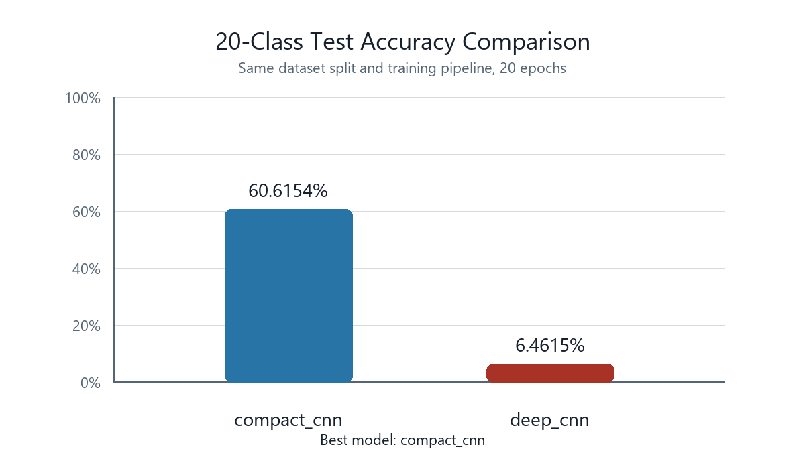

# DIT5411 Chinese Handwritten Character Recognition

This project implements the DIT5411 machine-learning assignment with
TensorFlow. It supports the 13,065-class full Chinese handwriting dataset
and its smaller 4,803-class common-word version.

The GitHub repository contains the source code and documentation only.
The image dataset, virtual environment, user samples, and trained `.keras`
models are not committed because of their size. Download the dataset and
train the models locally as described below.

Project repository: [github.com/qwern1/ict-5412-](https://github.com/qwern1/ict-5412-)

## Dataset layout

Extract the dataset so that each character has its own directory:

```text
dataset/
  class_00000/
    000.png
    001.png
    ...
  class_00001/
    000.png
    ...
```

The loader sorts each directory's image names, uses the first 40 images for
training, and reserves all remaining images for testing. It refuses to train
when a class has no held-out image.

The loader also accepts the downloaded archive layout, where images are
stored in nested directories and named like `漢字_20.png`. In that case, pass
the archive's `data` directory as `--dataset`; the filename prefix before the
last underscore is used as the character label.

## Augmentation and models

Each class starts with 40 training images. The training pipeline repeats those
images enough times to provide at least 200 examples per class and applies a
new random rotation, translation, and scale change to every repeated image.
Test images are never augmented.

Two models are trained and compared:

* `compact_cnn`: three convolution blocks and global average pooling.
* `deep_cnn`: four batch-normalised convolution blocks, dropout, and a dense
  layer.

Both models finish with a softmax layer whose width is the number of dataset
classes (13,065 for the full assignment).

## Download the dataset

Download the full dataset from the
[`handwritting_data_all`](https://github.com/chenkenanalytic/handwritting_data_all)
repository. On Windows, clone it into your `Downloads` folder and extract the
archive. Place the extracted `cleaned_data` folder in the project's `dataset`
folder:

```text
.\dataset
```

## Run

From the project directory, run:

```powershell
.\.venv\Scripts\python.exe train_character_recognizer.py `
  --dataset .\dataset `
  --output .\artifacts `
  --epochs 10 `
  --batch-size 128 `
  --expected-classes 13022
```

The training compares two CNN models and saves the results in `artifacts\`:

```powershell
artifacts\compact_cnn.keras
artifacts\deep_cnn.keras
artifacts\best_model.keras
artifacts\class_names.txt
artifacts\model_comparison.csv
```

`best_model.keras` is copied from the model with the highest held-out test
accuracy. Keep the generated files local; they are not required in GitHub.
Copy the two model accuracies from `model_comparison.csv` into the final
report.

The downloaded `Traditional-Chinese-Handwriting-Dataset-master` archive is the
4,803-character common-word dataset. Sixteen folders contain too few images for
the required first-40/remaining-test split, so the loader skips them and trains
on the 4,787 eligible classes. Use `--expected-classes 4787
--allow-different-class-count` when experimenting with that smaller dataset.

## Test handwritten recognition

To test the available trained model, start the recognition window:

```powershell
.\.venv\Scripts\python.exe draw_character.py
```

The program uses `full_trial_artifacts\compact_cnn.keras` and
`full_trial_artifacts\class_names.txt` by default. Custom model and label files
can still be supplied with `--model` and `--labels`.

Draw one Chinese character on the canvas and click **辨識**. The program
displays the most likely character and the five highest probabilities. Click
**清除** before drawing the next character. This interface accepts mouse
handwriting only; photograph upload is not supported.

### Recognition demonstration

The recognition window demonstrates that the application can visually analyse
handwritten strokes and make a character prediction. The result is not always
certain: the interface shows the predicted character, its confidence, and
the five most likely candidates. A low confidence score means that the model
can see the handwriting but is unsure which character it represents.

## Accuracy and result interpretation

Test accuracy is calculated using the held-out images that were not used for
training:

```text
test accuracy = correctly classified test images / all test images
```

The percentage printed after training is the measured accuracy of the selected
model on the test set. It is different from the confidence percentage shown
for one handwritten prediction. Confidence only describes that single
prediction.

### Training progress examples

The training result depends strongly on the number of classes and epochs:

* In a full-dataset run with 13,022 eligible classes and 10 epochs, the
  training accuracy reached approximately **25.76%** and the held-out test
  accuracy was **0.1237%**.
* In the complete 20-class experiment with 20 epochs, the held-out test
  accuracy reached **60.6154%**. This result is specific to the 20-class
  experiment and cannot be compared directly with the 13,022-class run.

The final result for the full dataset is recorded in `model_comparison.csv`
after training finishes. If classes with fewer than 41 images are skipped,
report the actual number of eligible classes and output neurons.

### Current test run

The current test run used the same training pipeline and produced these
held-out test accuracies:

| Model | Test accuracy |
|---|---:|
| `compact_cnn` | 60.6154% |
| `deep_cnn` | 6.4615% |

The best model in this run was `compact_cnn` at **60.6154%**. These values are
the final results for the 20-class experiment.

## Assignment deliverables

### Model structures

* **compact_cnn** uses three convolutional layers with 32, 64, and 128
  filters, max pooling, global average pooling, and dropout.
* **deep_cnn** uses four batch-normalised convolutional blocks with 32, 64,
  128, and 256 filters, followed by global average pooling, a dense layer,
  and dropout.
* Both models use a final softmax layer with one output neuron per character
  class.

### Augmentation method

The training set initially contains 40 images per character. The pipeline
repeats each class until it has at least 200 training samples and applies a
new random transformation to each sample:

* rotation up to 0.08;
* translation up to 10% horizontally and vertically;
* zoom between -15% and +15%.

The held-out test images are not augmented. The two models are trained with
the same split and augmentation settings so their test accuracies can be
compared fairly.

### Reported comparison

For the complete 20-class experiment, the comparison is:

| Model | Test accuracy |
|---|---:|
| `compact_cnn` | 60.6154% |
| `deep_cnn` | 6.4615% |

Therefore, `compact_cnn` is the selected model for the 20-class experiment.



## References

* [Traditional Chinese Handwriting Dataset](https://github.com/AI-FREE-Team/Traditional-Chinese-Handwriting-Dataset)
* [Handwritten Digit Recognition using Keras and TensorFlow](https://github.com/kimanalytics/Handwritten-Digit-Recognition-using-Keras-and-TensorFlow)
* [OpenCV Image Augmentation Reference](https://github.com/darshitajain/Introduction-to-OpenCV)

